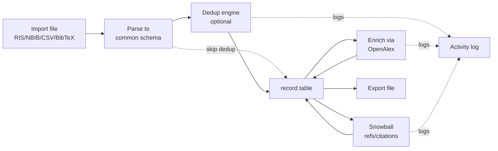

# srdatatools — Design Document

2026-09-18 · Emily

**srdatatools** is a local, open-source (MIT licensed), single-user desktop application for importing, merging, deduplicating, enriching, and exporting collections of academic paper metadata from multiple sources (RIS, NBIB, CSV/TSV, Excel, BibTeX), with OpenAlex as the enrichment source.

## Goals & scope

**Primary user:** researchers/students doing systematic reviews or literature management who want a free, local, open-source alternative to juggling exports from multiple databases by hand. This is a tool-first build — there's no single project driving it on a deadline — informed by having helped various people with exactly this kind of literature-wrangling problem before. Because there's no deadline pressure, correctness and robustness take priority over shipping speed: solid tests, clear data provenance, and reversible operations (see Data model) matter more than getting to a demo fast.

**v1 goals:**

- Import bibliographic records from RIS, NBIB (PubMed), CSV/TSV, Excel, and BibTeX files
- Import screening labels already assigned in a screening tool (e.g. ASReview), per phase and screener
- Store everything in one local database so multiple source files can be combined without duplicate entries
- Deduplicate records across sources (same paper appearing in e.g. both a PubMed and a Scopus export)
- Export the combined, cleaned collection to a new file (RIS/CSV at minimum)
- A GUI for import/export and dataset statistics (counts, sources, years, dedup results)
- Full transparency: every action (import, merge, dedup decision, enrichment) is logged and visible to the user
- Enrich records with metadata from OpenAlex (abstracts, citation counts, open-access links, missing fields)
- Snowballing: pull references/citations of a paper to discover related work

**Target scale:** libraries up to tens of thousands of records. This is large enough that naive all-pairs fuzzy matching (comparing every record to every other) becomes too slow, so dedup needs a blocking/indexing strategy rather than a brute-force approach (see Deduplication under Core workflows).

**Explicitly out of scope for v1** (candidates for later):

- Multi-user / shared database, cloud sync
- PDF full-text storage or full-text search
- Screening/tagging workflow for systematic reviews (inclusion/exclusion, PRISMA) — importing labels that were already assigned in a screening tool (ASReview, DistillerSR, Rayyan, …) is in scope; screening inside this app is not
- Reference-manager integrations (Zotero/Mendeley sync)
- Non-English source format support beyond what RIS/NBIB/CSV already carry
- Multiple separate library files / switchable "projects" — one fixed database in the app-data folder for v1
- Backup/restore or a full-database export feature — bibliographic export is the only backup mechanism

## Source database priority

Goal: support as many databases as possible, built in order of how widely used they are. Starting seven (plus the already implemented ASReview and OpenAlex profiles at the bottom):

| Priority | Database | Native export format(s) | Notes / quirks |
| --- | --- | --- | --- |
| 1 | PubMed | NBIB, MEDLINE (.txt), CSV | Well-structured tags; CSV export has fewer fields and packs volume/issue/pages into a Citation column |
| 2 | Scopus | CSV, RIS, BibTeX | CSV column names differ from other vendors; export field set is configurable by the user in Scopus itself, so mapping must be flexible, not fixed |
| 3 | Web of Science | RIS, "Plain Text" tagged format | WoS's own tagged format uses different two-letter tags than standard RIS in places; RIS export is more standard and likely the safer first target |
| 4 | IEEE Xplore | CSV, RIS, BibTeX | CSV export is common for IEEE; RIS export exists but is less commonly used in practice |
| 5 | Embase | RIS, CSV | Similar shape to PubMed/Medline records but with Embase-specific fields (e.g. Emtree terms) |
| 6 | PsycINFO | RIS, CSV (via EBSCO or ProQuest platform) | Field set and export mechanics depend on which platform (EBSCO vs ProQuest) the library uses — may need two sub-profiles |
| 7 | Zotero | RIS, CSV, BibTeX, CSL JSON | Reference manager rather than a database, so records may be incomplete or hand-edited; export fields and tags can vary with the item types in the user's library |
| — (implemented) | ASReview | CSV, TSV, Excel, RIS | Screening tool: its export is the input file with ASReview's label/note fields added (see ASReview below) |
| — (implemented) | OpenAlex | CSV, RIS, BibTeX (also a `.txt` tagged format, not yet supported) | Lists are `\|`-separated in CSV; only the CSV export is auto-detected, as the RIS and BibTeX exports carry nothing that marks them as OpenAlex |

**Design implication:** most of these export to RIS or CSV rather than a unique file format each. So the real challenge isn't "one parser per database" — it's that RIS tag usage and CSV column names vary by vendor. The parser architecture should be **format + vendor profile**, not just format: a shared RIS/CSV parsing core, with a per-database "profile" (tag/column mapping + quirks) layered on top. This makes adding a new database mostly a matter of writing a new profile rather than a new parser, and keeps the door open for scaling to "as many databases as possible" without the codebase growing linearly with the parser count.

**Parsing and cleaning.** Parsing always runs and reads the file as it is: values are stored as they come, apart from the mapping's own work (combining date and page parts, routing ISSN/ISBN, pairing author IDs). Fixing values is left to **Cleaning**, an optional (recommended) action run on stored records from the right panel. A profile is then a declaration: suggested mapping + per-row options, plus its parse settings. Each Type also gets a **default profile** used when Source is Unknown; a source profile builds on it. The profile only sets the defaults: the parse settings are shown, and can be changed, in the Parsing view (see Import flow), grouped into subject boxes:

- **Labeling** — *Include*, *Exclude*, *Maybe*, *Unlabeled* (text, values separated by `|`, not case-sensitive): extra label values that mean that decision, on top of the built-in spellings and overriding them (see Labels under Import flow). The ASReview RIS profile fills in `ASReview_relevant` / `ASReview_irrelevant` / `ASReview_not_seen`.
- **Ordering** — *Use first*: columns that share a target with another mapped column, read before the default top-to-bottom order, in the order listed.
- **[selected Type]** — CSV/TSV: the *field-size limit* (default 1,000,000 characters, for Scopus References cells; Python's csv limit is process-wide, so it is set before each parse). Plus read-only parser behaviour as grey text: BibTeX citation-key continuation (Scopus keys like `Wong200922,24`), the RIS rule that an author ID line only belongs to the author line directly above it (an affiliation line may sit in between, any other tag ends that author), and the RIS rule that text outside a record (e.g. ASReview's `1.` record numbers) is ignored rather than skipped. A Type with nothing of its own (NBIB, Excel) has no box.

**Cleaning** runs on the Table's current selection when there is one, otherwise the whole library. Its options are one library-wide set, remembered in `app_settings` when cleaning is run, shown in the same kind of subject boxes (see Cleaning flow). Each record is cleaned with its first source file's raw fields, mapping and Ordering, so steps that read a raw key work for any source. The steps run in a fixed order and running cleaning again changes nothing more:

- **ISSN/ISBN** — *Strip extras*: keep only the ISSN/ISBN-shaped values, dropping qualifiers like `(electronic)` or `(ISSN)`; the `issn` field keeps 8-digit values and the `isbn` field 10- or 13-digit ones, a value with none of them is kept. *Only keep one*: the first, unless the preferred qualifier picks another; when off, every value is kept (joined with `; `). *Preferred qualifier* (text, not case-sensitive, greyed out while Only keep one is off; default `Electronic`, for PubMed's `IS` lines).
- **Authors** — *Drop "et al."* (a trailing `et al.` in the names, with the separator before it); *Drop trailing* (strip `. , ; : …` and spaces from the end of the names, e.g. PubMed CSV's final period; off by default, as it also strips an initial's period). *Split authors*: the names and affiliations are joined with `|` instead of the file's separator, so each author can be told apart; a value that already holds `|` is left alone. Unsplit author IDs (`key:[value]`) are split the same way into `key:value` per author: several ID columns are matched by position (a column with a different author count is ignored and logged), and IDs already split are left alone. *Names separator*, *Affiliations separator* and *IDs separator* (text): the separator to split on; empty sniffs it per source file from the stored values: whichever of `|`, `;`, a line break or ` and ` occurs in the most values, earlier ones winning ties (never `,`, which also separates last and first names; nothing found, nothing split, and an unsplit ID column is then one author's ID). With Split authors on (the following are greyed out otherwise): *Scopus ID from name* (Scopus's `Doe, John (12345)`: the `(12345)` moves from the name to the author IDs as `scopus_author_id`; ids that can't be matched to the authors by position are dropped and logged, the names are still cleaned); *Strip extras* (drop trailing bracketed text from each name, e.g. a Scopus ID, without keeping it); *Affiliation start* (text: strip each affiliation up to this delimiter when the text before it starts with that author's last name, for Scopus's affiliations that start with the author's name; such an affiliation without the delimiter is only a name and is dropped; empty = off).
- **Dates** — *Clean up dates* (on by default): reads the publication date and writes it as `YYYY/MM/DD`, an unknown part left empty (`1994//`); a date that can't be read is kept as it is and logged. *Ambiguous dates* (dropdown, greyed out while Clean up dates is off): day before month (EU, the default) or month before day (US), used only for numeric dates where both numbers could be the month. Built-in patterns read `YYYY`, `YYYY-MM(-DD)`, `YYYY/MM/DD` (also with empty or named parts, as joined at import), RIS `YYYY/MM/DD/other`, NBIB `YYYY Mon (DD)`, `DD/MM/YYYY` (also `.` or `-`), `12 March 2020`, `March 12, 2020`, `Oct2021` / `Oct 2021` and `Fall2013` / `Fall 2013` (a season gives the year only).
- **Keywords** — *Split keywords* (on by default): each unsplit keywords value (`prefix:[value]`) is split into separate keywords, keeping its prefix (`Author:[a; b]` → `[Author] a`, `[Author] b`; `keywords:[a; b]` → `a`, `b`); keywords already split are left alone. *Keywords separator* (text, greyed out while Split keywords is off): the separator to split on; empty sniffs it per source file as for the author names (nothing found, the value is one keyword).
- **Empty values** — a list of *Ignore* text boxes, one value each (not case-sensitive, whole value), that count as empty in every plain text field and the author names and affiliations; default PubMed's `[Not Available].`. Typing in the last, blank box adds a new blank one; × removes a value. *Refill from raw*: fills an emptied field from the next column mapped to that field in its source file (following Ordering), from the stored raw fields.
- **Identifiers** — *Strip DOI* (keep only `10.xxxx/…`), *Strip PMID* (keep only the number).
- **Other** — *Pages set*: expand `512-4` to `512-514`, only when the second value is lower than the first; it runs last, so it also expands pages from Citation. *First pub. type*: keep the first of several publication type lines (NBIB). *Standardize pub. type*: map vendor publication types (RIS codes, BibTeX entry types, Scopus, OpenAlex, PubMed) to a fixed list (Journal article, Review, Book, Book chapter, Conference paper, Conference abstract, Thesis, Report, Dataset, Preprint, Letter, Editorial, Note, Erratum, Retraction), matched on the whole value, not case-sensitive; an unmapped type keeps its text.
- **From raw fields** — steps that read one raw key, even when that row was set to ignore at import: *Values in RIS notes* (Scopus `N1` lines: `EID: …` sets the `eid` other ID, `Conference name: …` fills an empty conference name), *Scopus EID from URL* (Scopus BibTeX's `url`), *Values from Citation* (PubMed CSV's `Citation` column packs volume, issue and pages, `Nature. 2023 Aug;620(7974):589-594. doi: …`; only that plain `;volume(issue):pages.` form is read, into fields that are still empty; article numbers, preprints, supplements and book chapters fill nothing).

**ASReview.** An ASReview export is its input file written back with ASReview's own fields added, so the ASReview profile builds on each Type's default profile and adds no vendor settings of the original source. CSV/TSV/Excel add an unnamed record-id column and `asreview_group_id`, `asreview_label`, `asreview_time`, `asreview_note` (`asreview_label` → Label, `asreview_note` → notes, the rest ignored); a RIS input comes back with rispy column names (`start_page`, `number`, `type_of_reference`, …), which the profile maps too. RIS keeps the original tags and adds `N1` lines (`ASReview_relevant` etc., `asreview_group_id: n`, `asreview_time: …`), so `N1` is suggested as Label. Detection checks ASReview first (an `asreview_label` header, also in an Excel header row, or an `N1  - ASReview_` line), since these files still carry the original vendor's markers.

## Architecture & tech stack

**Language:** Python throughout — one language for parsing, DB, GUI, and packaging keeps this approachable for open-source contributors.

**Stack:**

| Layer | Choice | Why |
| --- | --- | --- |
| Database | SQLite | Zero setup, single file in a fixed app-data folder (one library per install, no project switching), plenty for single-user scale |
| ORM | SQLAlchemy | Clean schema/migrations, avoids hand-written SQL scattered around |
| GUI | NiceGUI | Rich widgets (tables, file upload, charts) with far less code than Qt; runs as a local web server |
| Desktop shell | pywebview | Wraps the NiceGUI server in a native window — no "open your browser" step |
| Packaging | PyInstaller | One-click executable per OS (Windows/macOS/Linux), no Python install required for end users |
| HTTP client | httpx | Async-friendly calls to OpenAlex (other enrichment APIs later) |

**Developer logging:** stdlib `logging` to the console (WARNING and up; DEBUG with the `--debug` flag) and to a rotating `srdatatools.log` (1 MB × 3 files) in the app-data folder next to the database. It is separate from the user-facing activity log.

**Module layout** (`(planned)` marks modules not built yet):

```
app/
  models/
    record.py        # pydantic Record schema every parser normalizes to
  parsers/
    common.py        # result types shared by all parsers, the FileType literal, file decoding
    detect.py        # Type/Source auto-detection from file extension + content sniffing
    mapping.py       # generic input-key -> Record field mapping (CSV columns, RIS/NBIB tags, BibTeX fields)
    authors.py       # author-ID field format shared by the parsers and cleaning
    csv_.py          # generic CSV/TSV reader + column-mapping suggestions
    excel.py         # generic Excel (.xlsx) reader, reusing the CSV column mapping
    ris.py           # generic RIS tokenizer + tag-mapping suggestions
    nbib.py          # generic NBIB/MEDLINE tokenizer + tag-mapping suggestions
    bibtex.py        # generic BibTeX tokenizer + field-mapping suggestions
    quirks.py        # parse settings (label values, field-size limit, ordering)
    profiles/        # per-database tag/column mappings + parse settings
      base.py        # Profile/FormatProfile types
      default.py     # default profile per Type, used when Source is Unknown
      overview.py    # Parsing view boxes per Type + applying the Parsing choices; box types shared with Cleaning
      asreview.py
      openalex.py
      pubmed.py
      scopus.py
      web_of_science.py  # (planned)
      ieee_xplore.py     # (planned)
      embase.py          # (planned)
      psycinfo.py        # (planned)
  db/
    models.py        # SQLAlchemy models
    session.py       # engine/session setup, runs Alembic migrations
    store.py         # writes parsed records to the database, runs cleaning on stored records
    queries.py       # read queries for the GUI
    settings.py      # app_settings key/value read/write
    activity_log.py  # writes plain-language activity_log rows (for every module that acts)
    migrations/      # Alembic
  cleaning/
    steps.py         # cleaning steps and the order they run in, per record
    options.py       # cleaning options (remembered in app_settings) + their boxes
    quality.py       # data-quality checks per record, worked out from its fields (not stored), for the dashboard and the table
  dedup/             # (planned) matching strategies (DOI, fuzzy title+author+year)
  enrich/            # (planned) OpenAlex client, field-merging logic
  snowball/          # (planned) reference/citation graph traversal via OpenAlex
  export/
    columns.py       # export columns (one per output column) and their cell values
    options.py       # export options, remembered in app_settings
    csv_.py          # CSV writer
  gui/
    home.py          # the single page, wires the panes together
    layout.py        # three-pane shell
    library_nav.py   # left panel navigation
    export_flow.py   # export view in the middle panel
    cleaning_flow.py # cleaning view in the middle panel
    import_flow.py   # import view in the middle panel + the per-Type parser wiring it imports with
    library_dashboard.py # Library dashboard stats in the middle panel
    source_file_view.py # source-file detail view in the middle panel
    quirks_overview.py # subject boxes (Parsing and Cleaning views) + the Mapping | Parsing toggle, for the import, source-file, cleaning and export views
    record_table.py  # Library record table + its column settings view
    action_panel.py  # right panel actions + activity log
    mapping_table.py # field-mapping table (CSV columns, RIS/NBIB tags, BibTeX fields)
    busy.py          # runs slow work off the event loop, with a spinner dialog if it takes a while
    format.py        # shared count/source formatting and label/keyword setting keys
    about.py         # About view (version, license, third-party licenses) and Help view
  main.py            # launches pywebview + NiceGUI server
```

Keeping parsers/dedup/enrich/export as independent modules with a shared internal `Record` schema means each input/output format only needs a thin adapter, and new sources (e.g. Scopus, Web of Science exports) can be added later without touching the rest of the app.

## Data model

Core tables, kept normalized so the same paper found via two sources becomes one `record` linked to two `record_source` rows rather than two records. Tables marked *(planned)* don't exist yet.

| Table | Purpose |
| --- | --- |
| `record` | One row per imported record (pre-dedup), one per unique paper after dedup: title, authors (three strings: names, author IDs, affiliations; see Per-row options), abstract, publication date (a string, YYYY/MM/DD once cleaned), DOI, PMID and other ids, merged/enriched fields |
| `record_source` | Raw import: which file/source a record came from, its original raw fields (import time is on `source_file`) |
| `source_file` | Metadata about each imported file: path/name, format, source (the vendor profile, empty when Unknown), sheet (Excel only), import date, row count, skipped rows (row number + reason), and the field mapping used at import (chosen mapping, original suggestion, and per-column example values and fill counts), and the parsing (quirk) choices |
| `label` | Screening decisions imported from a label column: which `record` and `source_file` it belongs to, phase, screener, and the normalized value (include / exclude / maybe / unknown / unlabeled). A record can have several; removing a source file deletes its labels |
| `dedup_link` *(planned, Phase 2)* | Which raw `record_source` rows were merged into which `record`, match method used, confidence score, blocking key used |
| `enrichment_log` *(planned, Phase 3)* | What was fetched from OpenAlex for a record, when, and which fields it filled or overwrote |
| `citation_edge` *(planned, Phase 4)* | Snowballing results: `record_id` cites/is cited by `record_id` (or an external id not yet imported) |
| `activity_log` | Log of every user- or system-triggered action, for the transparency view, with a status (ok / warning, e.g. an import with skipped rows or a file that failed); the user can clear it |
| `field_merge_policy` *(planned, Phase 2)* | The default conflict-resolution chain, plus named field-group overrides and which fields belong to each |
| `app_settings` | Simple key/value local settings store — record-table column selection and label format, the Dashboard's hidden charts/tables, export and cleaning options; later OpenAlex polite-pool email, merge-policy defaults, etc. |

**Migrations** start from a single Alembic baseline (the earlier migrations were squashed into it before the app had any other users). From here on every schema change gets its own migration, since existing libraries are upgraded in place at startup.

**DOIs** are stored lowercased and without a `https://doi.org/` or `doi:` prefix (DOIs are case-insensitive, so this makes matching exact); the original value stays in `record_source`'s raw fields.

**Key design choice:** never destroy the originally imported data. `record_source` keeps the raw parsed fields forever, so *what was imported* is never lost — this is for transparency and audit, not for in-app undo. There is no built-in undo/rollback for merges or enrichment: the safety net is that the app makes it clear, before running dedup, that the user should **export the current library first** if they want a restore point. This keeps the merge engine and its data model simpler, at the cost of relying on the user's own exported backup rather than an in-app history.

## Core workflows



**Dedup is optional, not a required step.** The pipeline is Import → Parse → *(optional)* Dedup → Store → *(optional)* Enrich/Snowball → Export, and each optional stage can be skipped. This means the app is equally useful for simpler jobs: exploring a single file to understand what's in it, or converting one file straight from one format to another (e.g. NBIB to CSV) — no need to run merge/dedup when there's nothing to merge.

**Import & parsing.** Each format (RIS, NBIB, CSV, BibTeX) has its own parser that maps fields into the common `Record` schema, with a per-database vendor profile layered on top where one applies. CSV needs a column-mapping step in the GUI since headers vary by export source (Scopus, Web of Science, etc. all name columns differently). Import accepts multiple files per action (all sharing one source/type selection) and auto-detects type/source from file extension + content sniffing to prefill the source/type dropdowns; see GUI & UX design below for the full import flow. Import writes directly to both `record_source` (raw parsed fields) and `record` (one row per imported record, pre-dedup) — dedup is a separate, on-demand step the user triggers later over the whole `record` table, not something that happens automatically at import time. Text files are read as UTF-8 (with or without a BOM), falling back to cp1252; Excel means `.xlsx` workbooks only (no legacy `.xls`).

**Cleaning.** Optional and on demand, like dedup: the user runs it from the right panel on the selection or the whole library, and can run it again (see Parsing and cleaning). When it finishes the Dashboard is shown. Each run writes one activity-log entry with the number of records cleaned and changed, and below it one line per step that changed records, in the order the steps run (*Cleaned 1.000 records: 312 changed* / *Split authors: 300* / *Pages set: 40*).

**Deduplication.** At tens-of-thousands scale, comparing every record against every other (all-pairs) is too slow for fuzzy matching, so dedup uses **blocking**: records are first grouped into small candidate buckets (e.g. by normalized publication year + first few characters of first-author surname, or a title n-gram key), and expensive fuzzy comparison only runs *within* a bucket, not across the whole library. Layered checks, cheapest first: (1) exact DOI match (no blocking needed — indexed lookup), (2) exact PubMed/other id match, (3) blocked fuzzy match on normalized title + year + author overlap (e.g. rapidfuzz). The fuzzy-match confidence threshold is **user-adjustable**, defaulting to effectively requiring an exact match — so out of the box the tool only merges what it's certain about, and the user explicitly loosens the threshold if they want it to catch more near-duplicates (trading some risk of false merges for fewer missed ones). Matches below the active threshold are queued for manual review in the GUI rather than auto-merged — this is the main way the tool avoids silently corrupting data.

**Merge settings (configured before running dedup).** The user sets this up once (with sensible defaults, editable any time):

- **Matching fields:** which fields dedup uses to decide two records are the same (default: DOI, title, year, author overlap — user can add/remove).
- **Fuzzy-match confidence threshold: **how similar records must be to count as a fuzzy-match candidate. User-adjustable; default is effectively exact-match-only, so the tool starts conservative and the user opts into catching more near-duplicates.
- **Conflict resolution strategy:** when two matched records disagree on a field's value, how to pick the winner. A strategy is an **ordered fallback chain** of steps tried in order until one produces a non-empty value, for example `prefer source: PubMed → longest value → first-imported`. Available steps: prefer a named source, longest value, shortest value, first-imported, most-recently-imported, always ask (manual).
- **Scope of a chain:** one **default chain** applies to every field; the user can then define **one or more field-group overrides** — a named list of fields that use a different chain instead of the default (e.g. a "bibliographic core" group of title/authors/year using one chain, an "abstract" group using another). A field not listed in any override uses the default.

**Decision support.** Before the user commits to a strategy, the app shows a per-field report so the choice isn't a guess: for each field, what fraction of records have it populated per source, how often sources actually disagree on it (agreement rate) when the same paper appears in more than one, and a handful of real example conflicts pulled from the current library. Fields that rarely disagree don't need a special override; fields that disagree often and matter (e.g. abstract) are the ones worth a field-group chain.

**Manual dedup review.** A GUI screen shows candidate duplicate pairs side by side with their match score and reason, and lets the user confirm, reject, or edit before merging. Since merges can't be undone in-app, running dedup surfaces a clear one-time reminder to export the current library first if the user wants a restore point.

**Export.** Writes the records back out to CSV (RIS planned): the Table's current selection when there is one, otherwise the whole library, preserving as much of the original metadata as the format allows. On request it also writes the raw imported fields kept in `record_source`. See Export flow below.

**Enrichment (OpenAlex).** Explicit, not automatic: enrichment only runs when the user clicks "Enrich" for a record or a selected batch — never automatically on import — so the user always controls when API calls happen. For records with a DOI or title match in OpenAlex, pull abstract, open-access status/link, citation count, concepts/topics, and fill only fields that are empty locally by default (never silently overwrite user-verified data) — full details always visible in the enrichment log. OpenAlex's rate limits are much more generous for requests that include a "polite pool" email. The app stores this email locally once given (a per-installation setting), and if it isn't set yet, the GUI prompts for it inline the first time enrichment runs — the user can also skip it and enrichment still works, just at lower default rate limits.

**Snowballing.** For a chosen record (or set of records), fetch its references (backward) and citing works (forward) via OpenAlex's citation graph. Results always land in a **candidate holding area** — never straight into the library — where the user reviews and picks which to pull in. No default cap on how many candidates a round can fetch, since a well-cited paper's citing works can run into the hundreds; instead, before fetching, the app estimates the result size and shows a warning if it's large, so the user can confirm or narrow the request rather than being surprised by it. Repeatable across multiple rounds, forward and backward independently.

**Transparency.** Every import, merge, enrichment call, and snowball action writes to the activity log with a plain-language description, shown in the right panel's activity log — this is a first-class feature, not a debug log. Entries are short messages of a few lines (shown here separated by " / "), e.g. an import is *Imported from: / scopus.csv / Processed: 998 / Skipped: 2* and a failed file *Import failed: / scopus.csv / Reason: …*; an entry is green when ok and orange as a warning (rows skipped, a file that failed).

## GUI & UX design

**Layout:** a single-window, three-pane shell — no tabs, not a step-by-step wizard, since real usage jumps between actions rather than following one fixed order.

- **Left panel** — navigation: a **Library** heading with two entries for the full combined record set, **Dashboard** and **Table** (each has a gear icon that opens its settings), followed by a list of imported source files, one per `source_file` row. Selecting an entry drives what the middle panel shows; Dashboard is selected on app start. An **Import** button sits at the top of this panel.
- **Middle panel** — content for whatever is selected on the left:
  - **Dashboard** selected: a *Field completeness* bar chart (for title, authors, abstract, publication date, journal, DOI, PMID and keywords, the share of records with a value, the count on hover; a field every record has is lime green); a *Data quality* table (records per check: *Unparsed dates*, a date not in the cleaned `YYYY/MM/DD` form; *Misaligned authors*, author IDs still unsplit or with more authors than there are names; a count above 0 is red, 0 is green; its *Show in table* button, greyed out when every count is 0, sets the Table's columns to Data quality plus the columns of each check that found problems, saved like Table settings, and opens the Table filtered to records with a problem, sorted by Data quality); a *Publication year* bar chart (the year a date starts with, when it starts with four digits; every year from the first to the last, records without a year left out and counted in the title); a *Publication type* pie (values as stored, matched case-insensitively; the 7 most common get their own slice, the rest are summed into *Other*, and records without a type form *Unknown*); a *Source files* pie (records per imported file, same top-7 + *Other* rule, records linked to several files counted once in *Multiple files*); one pie per label phase + screener (include / exclude / maybe / unknown / unlabeled, records without a label for that pair counted as unlabeled); and one table per keyword prefix (unprefixed keywords under *Keywords*, others e.g. *Keywords: MeSH*) of the 10 keywords carried by the most records, matched case-insensitively (long keywords cut off with … and shown in full on hover). All charts and tables are the same size and flow left to right, wrapping onto the next line. Its settings have one checkbox per chart or table; the hidden ones are persisted in `app_settings`, so a new label pair or keyword prefix shows by default.
  - **Table** selected: all records in one unpaginated grid (horizontal scrolling for wide column sets), with column sorting and per-column header filters. Rows are selected by clicking or via checkboxes; the header checkbox selects all rows passing the current filters. Rows are compact (24px, small text); the Authors cell shows the names as stored. Hovering a column header shows its full name, and headers highlight on hover to show they can be clicked to sort. Above the grid: total rows, rows in filter (with *Clear all filters*) and rows in selection (with *Clear selection* and a red *Delete selected*, which asks for confirmation, removes the records with their labels, keeps their source files and logs the deletion). The selection is kept for the session (for the right-panel actions to run on later), not between sessions.
  - **Table settings** (gear beside Table): choose which record fields are shown as columns, in boxes by subject (General, Authors, Publication, Identifiers, Keywords with the prefix columns, Labels with the label columns and the label values choice); the grouping doesn't change the table's column order (including *Sources*: the vendor of each file the record came from, e.g. "PubMed, Scopus", Unknown for files imported without a source; *Publication year*: the year the date starts with, a number column; and *Data quality*: the record's data-quality problems joined with ` | `, empty when it has none), plus one optional column per label phase + screener combination in the library (e.g. *Label: ft / screener 1*, several values joined with "; ") and one per keyword prefix (e.g. *Keywords: MeSH*, prefix stripped; the plain *Keywords* column shows the unprefixed keywords), and a *Label values* choice of **Numbers** (1 / 0 / 0.5 / ?, the default) or **Words** (include / exclude / maybe / unknown), with unlabeled shown as an empty value in both, with *Restore defaults* (DOI, title, authors; Numbers). The choice is remembered between sessions in `app_settings`.
  - **A source file** selected: that file's info — rows originally imported from this file and rows currently in the library from it, side by side, how many rows were skipped on import (and why), and an option to remove all of this file's records from the library (see open question on how this interacts with records already merged via dedup), plus a read-only copy of the field mapping and parsing choices used at import, behind the same **Mapping | Parsing** toggle as the import view.
  - **Import** clicked: the middle panel is replaced by the import flow (below) until the user confirms or cancels.
- **Right panel** — one button per cross-cutting action, top to bottom: **Cleaning**, **Deduplicate**, **Enrich**, **Snowball**, **Export**. Deduplicate, Enrich and Snowball each have a small gear icon beside them that opens that action's settings in the middle panel (merge-settings for Deduplicate; polite-pool email/overwrite policy for Enrich; pre-fetch size-warning threshold for Snowball); Cleaning and Export have none, as their views hold their options. Below the five buttons, a read-only textbox shows the activity log, oldest first and scrolled to the newest entry — always visible, no separate tab needed. Actions refresh it after doing work that may have written to the log. Below the activity log, a red **Delete library** button removes all records and source files after a confirmation dialog showing the counts; the activity log and settings are kept, and the deletion is logged.

**Import flow.**

1. The user clicks **Import** in the left panel and picks one or more files via a native file-selector popup. All files in one Import action must share the same source/type; if the selected files' content looks like it spans more than one source, the user gets a warning to re-select.
2. The middle panel switches to the import view: two dropdowns, **Source** and **Type**, each listing that dropdown's implemented options plus an **Unknown** choice.
   - **Type** = file format (RIS / NBIB / CSV / TSV / Excel / BibTeX, tied to the generic parsers). Type is required — while it's Unknown, **Import** is disabled, with a "please select the type" tooltip.
   - **Sheet** (Excel only) = which tab of the workbook to read, a dropdown on its own row above Source/Type, defaulting to the first tab; changing it re-reads that sheet. The chosen sheet is stored with the source file and shown in its detail view. Excel import takes one file at a time: with several files selected, **Import** is disabled with an "Excel import takes one file at a time" tooltip.
   - **Source** = vendor profile, one option per implemented profile (e.g. PubMed, Scopus, OpenAlex, ASReview). Source may stay **Unknown**, meaning no vendor-specific field mapping is applied.
   - On upload, the app tries to auto-detect both from file extension + content sniffing and prefills the dropdowns (exact per-format/per-profile detection heuristics are an implementation detail, not specced here). A failed detection leaves a dropdown at Unknown rather than blocking the flow, except Type, which blocks per above.
   - The two dropdowns work independently — picking a Source doesn't filter Type's options or vice versa. If the chosen combination isn't one the source actually exports (e.g. PubMed + CSV), the app falls back to the default parser for the chosen Type with no vendor mapping, and shows an inline note next to Source: *"No profile for this source/type combination — using the default parser."*
3. Once a file and Type with a mapping renderer are set, a field-mapping table appears inline in the import view itself, directly below the Source/Type dropdowns — no separate screen or confirm step. It's pre-filled with suggested field mappings and stays editable; **Import** always reads whatever the table currently shows at the moment it's clicked. A row set to ignore is never used, not even when pairing author IDs with author names; only the Cleaning steps that read one raw key (From raw fields) still read it later. (Today CSV, TSV, Excel, RIS, NBIB and BibTeX share the same mapping table: CSV, TSV and Excel rows are the file's (or sheet's) columns, RIS rows are the tags found in the file (except `ER`), NBIB rows are the tags found in the file plus a derived `DOI` row (taken from the `AID`/`LID` entry ending `[doi]`), BibTeX rows are the fields found in the file plus `@type` (entry type) and `@key` (citation key), pre-filled from a default tag mapping. Rows have no delimiters: Cleaning's *Split authors* and *Split keywords* split the values. Each row also shows an Example: the first non-empty value of that column or tag, truncated, with the full value on hover.)
   - **Labels:** any number of rows can map to **Label**, for screening decisions. Picking it shows two stacked boxes under the dropdown, **phase** and **screener** (grey placeholders `ft` / `screener 1`, used when a box is left empty). Values are normalized case-insensitively: include (`include`, `included`, `yes`, `y`, `1`, `true`, `relevant`), exclude (`exclude`, `excluded`, `no`, `n`, `0`, `false`, `irrelevant`), maybe (`maybe`, `unsure`, `undecided`, `?`), unlabeled (empty cell, or ASReview's `-1`), plus the values listed in the Parsing view's Labeling box, which take precedence (e.g. `-1` under Exclude); anything else is stored as unknown (red in the Result column) and logged. A multi-line value (e.g. RIS `N1` notes) is read line by line: the first line that is a label value wins, and none matching means unlabeled. CSV/TSV/Excel headers `included`, `label_included`, `label`, `decision` and `inclusion` are suggested as Label.
4. **Import** parses for real and writes both `record_source` (raw fields) and `record` (one row per imported record, pre-dedup). Malformed rows are skipped, logged, and rolled into the file's skipped count, consistent with the general malformed-record handling; this includes a record whose values fail to parse (the error is the skip reason). Each file of a multi-file import is stored on its own: a file that can't be read (e.g. moved since it was picked, or undecodable) is skipped, gets a warning entry in the activity log and a notification, and doesn't undo the files that did import.
   - **Per-row options:** the dropdown has one entry per target, and picking a target with options shows its inputs stacked under the dropdown, always visible (like Label). Text boxes left empty use the grey placeholder (the option's default, or the profile's suggested value). Any number of rows may map to the same target; where only one value can be kept, the first row in the table that gives one wins. Switching a row to another target and back restores its suggested options. Each option box is tinted like the dropdown: blue when its value differs from the suggested one, orange when it is worth a look (no example name contains the name separator, the example date is ambiguous for the order box, or the row's Result is red), green otherwise. The checks only use the example, the first non-empty value of that column or tag.
     - **Publication date:** part (full / year / month / day). The date is stored as a string: the first non-empty full date as it is; without one, the year, month and day parts joined as `YYYY/MM/DD` as they are, a missing part left empty (`1994//`, `2020/Mar/`). Cleaning's *Clean up dates* reads it.
     - **Pages:** part (range / start / end / number of pages); with start + number of pages, end = start + count − 1. A range wins over start/end.
     - **Authors:** role (names / author IDs / affiliations); author IDs also show an ID key box (e.g. `scopus_author_id`, `orcid` for an ORCID column). A record keeps three author strings. Names and affiliations are stored as they come, not split (Cleaning's *Split authors* does that): a CSV/TSV/Excel cell as-is, RIS/NBIB lines and BibTeX's `and`-separated names joined with `|`; when several rows give names (or affiliations), the first non-empty one is used. Split author IDs are `key:value`, grouped per author: `, ` between the ids of one author, `|` between authors, and an author without ids keeps an empty slot (`orcid:0000-0002-1825-0097, scopus_author_id:123||scopus_author_id:456`); an id already in an author's slot isn't added again, and an ORCID URL prefix is always stripped. A CSV/TSV/Excel or BibTeX ID column is stored unsplit as `key:[value]`, several columns joined with `, ` (`scopus_author_id:[123; 456]`); Cleaning's *Split authors* splits it. In RIS and NBIB an ID line belongs to the name line above it (NBIB AUID `ORCID: …` gives the key `orcid`, another scheme its own lowercased name); NBIB AD and AUID lines under an editor or before the first author are left out.
     - **Keywords:** prefix, a bare name (e.g. `Author`, NBIB `MH` → `MeSH`; typed brackets are dropped). Split keywords are stored as `[name] keyword`, so an export can split the prefix off again. A CSV/TSV/Excel or BibTeX keywords column is stored unsplit as one `prefix:[value]` keyword, `keywords:[value]` without a prefix (`Author:[fossils; dinosaurs]`); Cleaning's *Split keywords* splits it. RIS and NBIB keyword lines are one keyword each.
     - **ISSN/ISBN:** auto / ISSN / ISBN; the whole value is stored. Auto picks the field from the first ISSN-length (8 digits) or ISBN-length (10 or 13) number, falling back to ISSN with a warning. Stripping qualifiers and keeping one value are Cleaning steps.
     - **Other ID:** editable key name (defaults to the slug of the column name).
   - **Quirks overview (Parsing):** a **Mapping | Parsing** toggle above the table switches between the mapping table and the quirks overview, the selected one highlighted; both keep their edits while hidden, and a Source/Type change resets Parsing to the new profile's defaults but keeps the selected view. Parsing shows the subject boxes (see Parsing and cleaning under Source database priority) side by side where they fit within the mapping table's width, wrapping onto the next line otherwise, so toggling never resizes the panes; every box is as wide as the widest box needs (measured in the browser, as CSS alone can't equalize wrapping boxes) and a thin grey border with its title centred in the top line, and the selected profile's defaults pre-set. All text in Parsing is small (`text-xs`, box titles `text-sm`). Each item is one row: its label, then exactly one control — a checkbox, text box or dropdown — or, for parser behaviour, the label alone as grey text; the controls line up in one column within each box. Hovering a label shows what the item does. Checkboxes, text boxes and dropdowns have no colour while at the profile default and turn blue when changed; they are no taller than a line of text. Ordering is a list: an entry has a small red remove button, and a blank entry at the bottom adds the next one once something is picked. Ordering offers the columns that currently share a target and refreshes whenever Parsing is shown, keeping a pick that no longer shares one. A **Restore defaults** button at the bottom right resets every Parsing choice to the profile's defaults. The Result column follows the Parsing choices when switching back to Mapping, and **Import** uses them; they are stored with the source file, and the source-file view shows them read-only (choices stored before the subject boxes show the profile's defaults; stored choices that are now Cleaning options are left out).
   - **Dates from several rows:** the first full date row that gives a value wins, following the Parsing view's *Use first* (the default RIS profile lists `DA`, which usually holds more than `PY`); year, month and day each come from the first row of that part, and are only used without a full date.

**Cleaning flow.** Cleaning replaces the middle panel with the cleaning view, until another entry is picked: the number of records it will run on (marked *selected* for a selection), the Cleaning subject boxes (see Parsing and cleaning) laid out and styled like Parsing, opening on the remembered options with anything that differs from the built-in defaults in blue, a **Restore defaults** button (built-in defaults), and a **Run cleaning** button below the boxes (disabled when there are no records). Running cleans, remembers the options, logs the run, shows a notification and keeps the view open.

**Export flow.** Export replaces the middle panel with the export view, until another entry is picked.

1. Top: the target file with a **Save as…** button (native save dialog, `library.csv` by default), **Type** (CSV for now), and a line saying what is exported: *Exporting 12 selected records* when the Table has a selection, else *Exporting all 1.234 records*.
2. A **Mapping | Options** toggle, as in the import view.
   - **Mapping:** one fixed row per output column (no adding, removing or reordering), in order: Record ID, Title, Authors, Author IDs, Affiliations (the three written as stored), Publication date, Journal, Conference, Volume, Issue, Pages, Abstract, DOI, PMID, ISSN, ISBN, one row per other-ID key, Publication type, Keywords and one row per keyword prefix (prefix stripped), Language, Publisher, URL, Notes, one row per label phase + screener, Sources (vendors, as in the Table), Source files. A row none of the exported records has a value for is left out unless **Export empty columns** is on. Each row shows a fill bar (records among the exported ones with a value, coloured as in the import table), the field, an **Export as** text box with the CSV header and an Example (the first non-empty value, full value on hover). The header starts at the field's name; emptying it leaves the column out and turns the box red, a changed name turns it blue. Per-row options sit under the box: Publication date part (full / year / month / day; full writes the date as stored, a part is only read from a cleaned `YYYY/MM/DD` date and is empty otherwise); Keywords delimiter (`; `). Several label values for one phase + screener are joined with `; `.
   - **Options:** boxes like Parsing. *File:* delimiter (comma / semicolon / tab), encoding (UTF-8 with BOM, the default, so Excel shows accented characters correctly / UTF-8) and maximum length (default 131.072 characters, the default limit of Python's CSV reader, which many tools use; import raises its own limit, other programs may not; longer values are cut, an emptied box uses the default). *Values:* label values (Numbers / Words, as in the Table settings) and line breaks inside values (kept within quotes / replaced with a space). *Column selection:* **Export empty columns** (off) adds the rows none of the exported records has a value for; **Export ignored input columns** adds a row per raw key the file's mapping set to ignore; **Export original data** adds a row per raw key (and greys out the first). Raw rows come last, named after the key, with *(original)* appended when that clashes with a record column; a record whose sources disagree on a key gets their distinct values joined with `; `. Toggling either (or Export empty columns) rebuilds the rows, keeping edited names. Type and the Options are remembered in `app_settings`, with **Restore defaults**; the mapping rows are rebuilt each time.
3. **Export** (disabled until a file is chosen, or with no records) writes the file, logs *Exported to: / library.csv / Records: 1.234*, shows *Exported 1.234 records to library.csv* and returns to the Library Dashboard. Values cut to the maximum length make both a warning (*Values cut: 3* in the log, *; 3 values cut to 131.072 characters* in the notification). A write that fails is logged as a warning and shown as a notification, and the export view stays open.

**Visualizations:** valued highly (e.g. publications-per-year charts, source-overlap Venn diagrams), but in service of the workflow rather than cluttering it — shown in the middle panel when Library is selected, a few well-chosen, contextually placed visuals rather than a wall of graphs. The Dashboard holds the current set (completeness, publication year, publication type, source files, labels, keywords); further visuals, such as dedup status or source overlap, are added iteratively as the app takes shape (see Phase 5), not fully speced up front.

## Related work

Nothing found combines all of this project's pieces (multi-format import + a persistent local combined database + configurable dedup + OpenAlex enrichment + snowballing + full transparency) in one open-source, local-first tool. Closest existing projects, for reference and implementation ideas:

| Tool | Overlap | Gap vs. this project |
| --- | --- | --- |
| [Proportione/prisma](https://github.com/Proportione/prisma) (Python, MIT) | OpenAlex ingestion, cross-source dedup, PRISMA output | Built around the screening/PRISMA workflow, not a general import/store/export tool |
| synthesisr (R package) | Imports RIS/BibTeX/ciw, merges and deduplicates | R library, no GUI, no OpenAlex, no snowballing |
| ASySD (R/Shiny, open source) | Fast, interoperable dedup for biomedical reviews | Dedup-only, no import-format breadth, no enrichment/snowballing |
| citationchaser (R/Shiny, EPPI-Centre, open source) | Forward/backward citation snowballing | Standalone tool, not integrated with import/dedup/storage |
| Rayyan, Covidence, EPPI-Reviewer, Colandr, CADIMA | Import + dedup + screening at scale | Cloud-hosted, mostly closed-source/commercial, screening-first rather than library-first |
| JabRef, Zotero | Broad import support, general reference management | No OpenAlex enrichment, no snowballing, only basic dedup |

**Takeaway:** this project's niche is being local-first and general-purpose (not locked into a screening/PRISMA workflow) while still treating import → combined storage → configurable dedup → enrichment → snowballing → export as one transparent pipeline.

## Feature to-do list

**Phase 0 — Foundation**

- [x] Define the common internal `Record` schema (fields every parser normalizes to)
- [x] Set up SQLite + SQLAlchemy models + Alembic migrations
- [x] Project scaffolding, packaging pipeline (PyInstaller) proven end-to-end early, even with a trivial GUI
- [x] Test suite + CI set up from day one (pytest + GitHub Actions or similar), running on Windows, macOS, and Linux — every parser and dedup rule gets tests as it's written, not bolted on later; data-handling correctness is a core goal, not a nice-to-have
  - Large local vendor exports (`tests/data/<vendor>/*_big_*`) are parsed by tests marked `big`, skipped by default and run with `pytest -m big`
- [x] Contribution basics for open source: CONTRIBUTING.md, code style/lint config, issue templates

**Phase 1 — Import & storage (MVP)**

- [x] Generic RIS tokenizer/parser
- [x] Generic NBIB/MEDLINE tokenizer/parser
- [x] Generic BibTeX tokenizer/parser
- [x] Generic CSV reader (column-mapping logic)
- [x] Generic TSV reader (column-mapping logic)
- [x] Generic Excel reader (column-mapping logic)
- [x] Field-mapping UI, embedded inline in the import view (live table below Source/Type, no separate screen/confirm step)
- [x] Field-mapping UI: visual indicators (different colors) per row for columns that are mapped directly (exact alias), mapped via fuzzy match or the ID fallback, or mapped multiple times to the same target
- [x] Field-mapping UI: show the first value of each column/tag next to its row so the user can see what it contains
- [x] Field-mapping UI: "ISSN/ISBN" target that routes a single input (e.g. RIS `SN`) to `issn` or `isbn` by value length; NBIB `ISBN` tag mapped to `isbn`
- [x] Field-mapping UI: per-column bar (`#` column) showing filled rows / total rows, colored green (≥ 2/3 filled), orange (≥ 1/3) or red (< 1/3), with `value of total` on hover
- [x] Field-mapping UI: "Result" column showing how each example value parses under the selected source/type, with green text when the result differs from the example and red when it doesn't parse
- [x] Screening labels: "Label" mapping target with phase/screener boxes, normalized values stored in a `label` table (removed with its source file / on library wipe), one optional record-table column per phase + screener
- [x] NBIB: strip the print/electronic qualifier from `IS` values (e.g. `1234-5678 (Print)` -> `1234-5678`) before storing in `issn`
- [x] PubMed profile (NBIB, CSV)
- [x] PubMed quirks
- [x] PubMed CSV: read volume/issue/pages from the Citation column (plain `;volume(issue):pages.` form only, filling empty fields)
- [x] Scopus profile (CSV, RIS, BibTeX)
- [x] OpenAlex profile (CSV/RIS/BibTeX)
- [x] Shared quirks: refactor all profile fixes and data-changing generic fixes into shared, parametrized quirks; profiles (plus a default profile per Type for Unknown source) declare which are on and their arguments; behaviour-preserving, no UI change
- [x] Per-row mapping options (date, pages, authors, keywords, ISSN/ISBN, Other ID) replacing the split date/page/ISSN targets and the global list delimiter
- [x] Quirks overview in the import view: toggleable quirks with on/off and settings, always-on quirks with settings, parser behaviour read-only, each with an explanation
- [x] ASReview profile (CSV/TSV/RIS/Excel)
- [x] Store parsed records, keep raw source data (`record_source`)
- [x] Three-pane GUI shell: left navigation panel, middle content panel, right action panel (no tabs)
- [x] Left panel: Library entry + list of imported source files (from `source_file`), selecting an entry drives the middle panel; Import button
- [x] Import flow: single-file picker (native file dialog) through to storing records
- [x] Import flow: multi-file picker (one source/type per import action), warning when selected files' content looks like it spans more than one source
- [x] Auto-detection of type/source from file extension + content sniffing, prefilling the Source/Type dropdowns
- [x] Source/Type dropdowns: implemented profiles/formats + "Unknown"; Type required (Import disabled with a tooltip while Unknown); mismatched Source/Type combination falls back to the default parser with an inline notice
- [x] Import action: writes `record_source` + `record`, per-file "N imported, M skipped" summary
- [x] Activity log: write a plain-language `activity_log` row for each import (e.g. *Imported from: / scopus.csv / Processed: 998 / Skipped: 2*)
- [x] Source-file detail view: records currently in library from this file, skipped-row count, remove-this-source's-records action, read-only copy of the field mapping used at import
- [x] Delete/wipe the database: action that removes all imported records and source files
- [x] Right panel: Dedup / Enrich / Snowball / Export buttons in order, each with a gear icon opening its settings in the middle panel, read-only activity log textbox beneath
- [x] Middle panel Library view: Dashboard (field completeness, publication year, publication type and source files pies, label pies, keyword tables) + record table with sorting, column filters, row selection and persisted column settings

**Phase 2 — Export & dedup**

- [ ] Export to RIS
- [x] Export to CSV
- [x] Authors as three raw fields (names, author IDs, affiliations) instead of structured, split authors; disabled Cleaning action at the top of the right panel as the future home of cleaning steps
- [x] Cleaning: move the author quirks (and other Parsing options) from Parsing to the Cleaning action, run on the library
- [ ] Exact-match dedup (DOI, PubMed ID)
- [ ] Per-field conflict resolution engine: default strategy chain + named field-group overrides (prefer source, longest/shortest, first/most-recent import, manual)
- [ ] Merge-settings GUI: configure matching fields, default chain, and field-group overrides
- [ ] Per-field completeness/agreement report to inform the user's strategy choices before running dedup
- [ ] Adjustable fuzzy-match confidence threshold control in the merge-settings GUI, defaulting to exact-match-only
- [ ] Blocking strategy for dedup (group candidates by year + author-surname prefix or title n-gram key, so fuzzy matching stays fast at tens-of-thousands scale)
- [ ] Fuzzy dedup within blocks (title + author + year similarity)
- [ ] Manual dedup review screen (accept/reject/edit candidate merges)
- [ ] One-time "export first?" reminder before running dedup, since merges can't be undone in-app
- [ ] Activity log: record every merge/export action

**Phase 3 — Enrichment**

- [ ] OpenAlex API client
- [ ] "Polite pool" email stored in `app_settings`; prompt shown inline on first enrichment run if not already set, skippable
- [ ] Field-filling logic (only fill empty fields by default; user can force-overwrite)
- [ ] Enrichment review/log UI
- [ ] Explicit "Enrich" action in the Library GUI: per-record and per-selected-batch, no automatic enrichment on import

**Phase 4 — Snowballing**

- [ ] Fetch references (backward snowballing) via OpenAlex
- [ ] Fetch citing works (forward snowballing) via OpenAlex
- [ ] Candidate-review UI before pulling snowballed records into the library
- [ ] Pre-fetch size estimate + warning for large snowball requests (no hard cap, but the user is warned before a huge fetch runs)
- [ ] Track snowball provenance (which record led to which)

**Phase 5 — Polish & packaging**

- [ ] Dashboard: add dedup-status charts and other visuals as needed (records per year and per source file already exist)
- [ ] One-click installers for Windows/macOS/Linux
  - Bundle a third-party license notices file (MIT/BSD/Apache-2.0/MPL-2.0 dependency copyrights) alongside the PyInstaller-built binary — pip-installed/source use is covered by each package's own `site-packages` license file, but a frozen executable needs its own attribution file (done: `THIRD_PARTY_LICENSES.txt` plus a one-line-per-component `THIRD_PARTY_SUMMARY.txt`, generated by `packaging/third_party_licenses.py` per platform, bundled by the spec and shown in the About view)
- [x] About view (bottom of the left panel): name, version, description, repository link, own license and third-party licenses
- [ ] Help view (bottom of the left panel, currently a placeholder): how to use the application
- [ ] User docs / README for open-source release
  - Add a `[project.scripts]` entry point so `pip install` provides a `srdatatools` command (currently only the importable `app` package, launched via `python -m app.main`)
- [ ] Broaden test coverage to integration tests across the full import → dedup → enrich → export pipeline

**Phase 6 — Adding more input**

- [ ] Zotero profile (RIS/CSV)
- [ ] Zotero profile: Zotero BibTeX mapping
- [ ] Zotero profile: generic CSL JSON parser + Zotero CSL JSON mapping
- [ ] Web of Science profile (RIS)
- [ ] Generic Web of Science "Plain Text" tagged parser + mappings for WoS and OpenAlex (OpenAlex's `.txt` export uses this format)
- [ ] IEEE Xplore profile (CSV)
- [ ] Embase profile (RIS/CSV)
- [ ] PsycINFO profile — EBSCO and ProQuest variants (RIS/CSV)
- [ ] DistillerSR profile (CSV/Excel/RIS), including its screening labels
- [ ] Rayyan profile (CSV/RIS/BibTeX), including its screening labels

**Backlog / stretch**

- [ ] Additional import formats/profiles as usage grows, roughly in order of commonality: EndNote XML next, then further databases beyond the starting six
- [ ] Tagging / notes on records
- [ ] Additional enrichment sources beyond OpenAlex (Crossref, Semantic Scholar) as fallbacks or supplements

## Open questions

- [ ] Once a user loosens the fuzzy-match threshold below exact-match, should matches above a high-confidence level auto-merge, or should every merge always go through manual review?
- [ ] When a user removes a source file's records from the library, and some of those records were merged via dedup into a combined `record` that also has data from another source, what should happen — strip just that source's contribution from the merged record (leaving it intact via the other source), or only allow removal of un-merged/standalone records, with merged ones needing separate handling?
